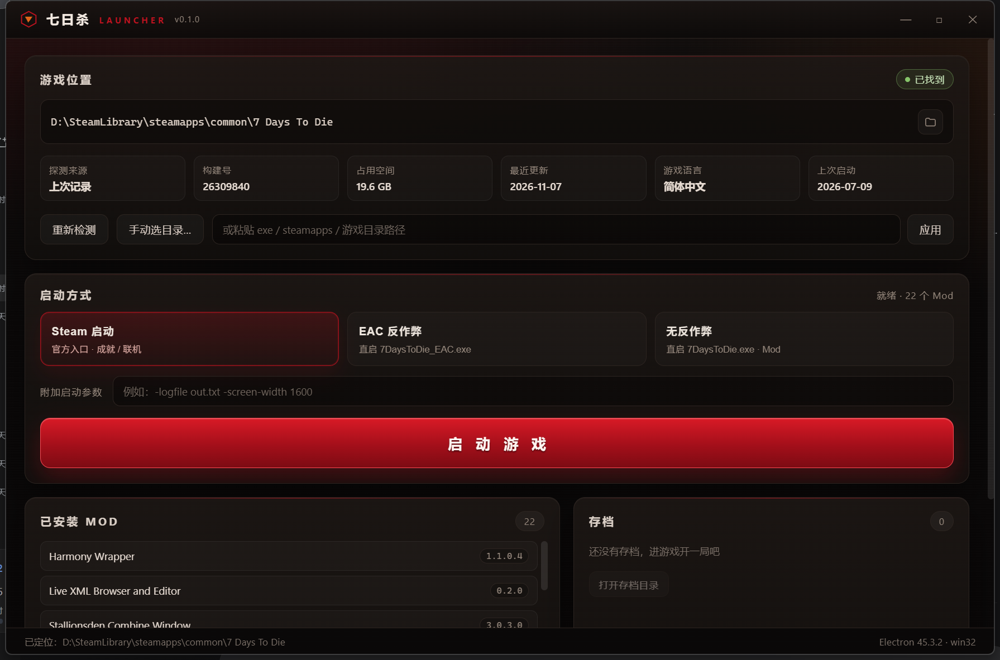

# 七日杀启动器

《七日杀》（7 Days to Die）的 Windows 桌面启动器，基于 Electron。
打开即自动定位 Steam 安装的游戏，显示安装信息、Mod 与存档，一键启动。



## 功能

- **自动检测游戏目录**：Windows 注册表 → Steam 库配置 → 常见磁盘位置，多级兜底；完全找不到时支持手动选择或粘贴路径。
- **安装信息总览**：游戏路径、探测来源、构建号、占用空间、最近更新时间、语言、上次启动时间。
- **三种启动方式**：
  - `Steam 启动`：走 `steam://rungameid/251570`，保留成就与联机；
  - `EAC 反作弊`：直接运行 `7DaysToDie_EAC.exe`；
  - `无反作弊`：直接运行 `7DaysToDie.exe`，加载 Mod 时使用。
- **附加启动参数**：例如 `-logfile out.txt -screen-width 1600`，按空格切分并支持引号包裹。
- **Mod 一览**：读取 `Mods` 目录下每个 Mod 的 `ModInfo.xml`（名称 / 版本），标记缺少描述文件的目录与未解压压缩包。
- **存档一览**：统计 `%APPDATA%\7DaysToDie\Saves` 与 `SavesLocal` 的世界与存档数量、体积、最后保存时间。
- **记住选择**：游戏路径、启动方式、附加参数写入 `%APPDATA%\<应用名>\settings.json`。

## 检测逻辑

游戏在 Steam 里的 AppID 是 `251570`，主程序为 `7DaysToDie.exe`。检测按以下顺序进行，命中即止：

1. 上次记录的路径 / 手动指定的路径；
2. 注册表：
   - `HKCU\Software\Valve\Steam` 的 `SteamPath`
   - `HKLM\SOFTWARE\WOW6432Node\Valve\Steam` 与 `HKLM\SOFTWARE\Valve\Steam` 的 `InstallPath`
3. 各 Steam 库根目录下的 `steamapps\libraryfolders.vdf`（同时兼容新版 `"path"` 与旧版数字键两种写法）；
4. 每个库里解析 `steamapps\appmanifest_251570.acf`，取其 `installdir` 定位 `steamapps\common\<installdir>`；
5. 仍找不到时，扫描 C:–Z: 的常见布局：`SteamLibrary`、`Steam`、`Games\SteamLibrary`、`Program Files (x86)\Steam`、`Program Files\Steam`。

Windows 上目录名大小写并不可靠（本机 `appmanifest` 里写 `7 Days To Die`，磁盘上却是 `7 Days to Die`），所有路径解析均忽略大小写。

## 开发

要求：Node.js ≥ 22、Windows。

```bash
npm install        # 安装 Electron
npm start          # 启动应用
npm run dev        # 启动并打开开发者工具
npm test           # 运行单元测试（node:test）
```

### 目录结构

```text
src/
  main/
    main.js            Electron 主进程：窗口、IPC、启动逻辑
    preload.js         contextBridge 暴露 window.launcher
    steam-locator.js   注册表 / libraryfolders.vdf / appmanifest / 扫盘定位
    game-info.js       Mod 与存档统计
    launcher.js        启动计划与参数切分
    settings.js        轻量 JSON 设置存储
  renderer/
    index.html
    styles.css
    renderer.js
test/                  node:test 单元测试
```

安全边界：渲染进程禁用 Node、开启 `contextIsolation` 与 `sandbox`；「打开文件夹」类操作只接受 `game | mods | saves | userdata` 四个白名单枚举，路径在主进程内解析，不接受渲染层传入的任意路径。

## 打包

```bash
npm run dist        # 便携版 exe（需先 npx electron-builder install-app-deps 或直接安装 electron-builder）
npm run dist:nsis   # NSIS 安装包
```

`electron-builder` 未随仓库安装，避免把几百 MB 的打包链塞进依赖；首次打包让 npx 自行拉取即可。图标放在 `build/icon.ico`。

## 许可证

MIT © 2026 Sole0nce
